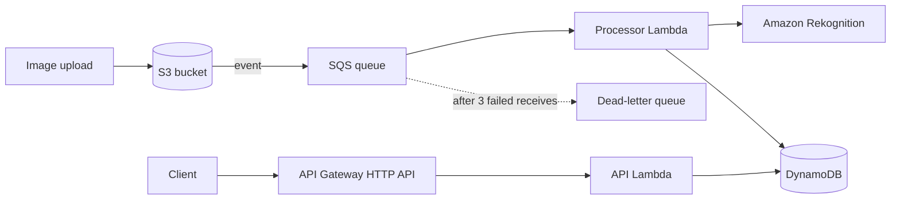

# Event-Driven Image Labeling Pipeline


A serverless, event-driven AWS pipeline that automatically labels uploaded images with Amazon Rekognition and exposes the results through a REST API. Infrastructure is defined as code with AWS SAM and deployed automatically by GitHub Actions.

## Architecture



**Flow:** an image uploaded to S3 triggers an event into SQS. The processor Lambda reads from the queue, calls Rekognition to detect labels, and stores the results in DynamoDB. A second Lambda behind API Gateway serves the results.

## Key design decisions

- **Decoupled with SQS:** uploads never wait on processing, and traffic spikes are absorbed by the queue.
- **Dead-letter queue:** messages that fail repeatedly are moved aside for inspection instead of blocking the queue.
- **Partial batch failure handling:** if one image in a batch fails, only that message is retried. The rest of the batch is not reprocessed.
- **Infrastructure as code:** the entire stack is defined in `template.yaml` (AWS SAM / CloudFormation) and validated with `cfn-lint`.

## API

| Method | Path | Description |
|---|---|---|
| GET | `/images` | List all labeled images |
| GET | `/images/{image_key}` | Get labels for one image (404 if not found) |

Example:

```bash
curl https://7ihoz1j4d1.execute-api.ap-south-1.amazonaws.com/images
```

<!-- Add a screenshot of the API response or the DynamoDB item here -->


## CI/CD

Every push to `main` runs the pipeline in `.github/workflows/ci.yml`:

1. **Lint:** `cfn-lint` validates the SAM/CloudFormation template.
2. **Test:** `pytest` runs unit tests with mocked AWS services (success, partial failure, and 404 cases).
3. **Deploy:** the workflow authenticates to AWS with **GitHub OIDC** (no long-lived access keys stored in GitHub), then runs `sam build` and `sam deploy`.

Pull requests run lint and test only. Deployment happens only on `main`.

The IAM role trust policy is restricted to this repository's `main` branch.

## Run locally

```bash
pip install boto3 pytest cfn-lint
cfn-lint template.yaml
pytest -v
```

## Deploy manually

```bash
sam build
sam deploy --guided
```

## Tech stack

AWS Lambda, S3, SQS, DynamoDB, API Gateway, Rekognition, IAM, CloudFormation, AWS SAM, GitHub Actions, Python

## Cleanup

Empty the S3 bucket, then delete the `image-label-pipeline` stack in CloudFormation. Pushing to `main` recreates everything.
